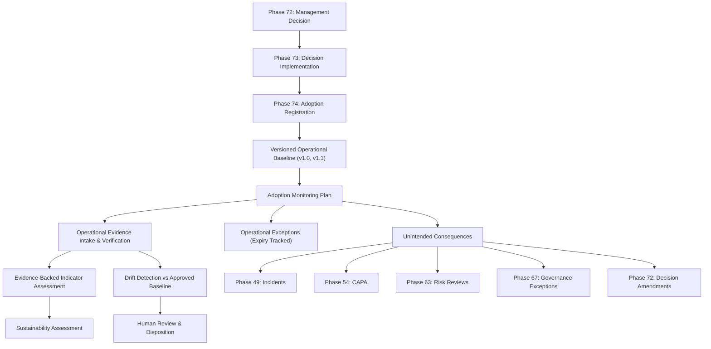

# Phase 74: Governance Change Adoption, Operational Sustainability & Implementation Drift Monitoring

## 1. Overview & Objectives

Phase 74 establishes an authoritative, governed backend capability for **HealthSetu** to monitor whether approved clinical safety governance changes are being adopted across intended operational environments, remain incorporated into routine workflows, and continue to be adhered to following implementation.

Building directly on Phase 73 (Decision Implementation and Outcome Assurance) and Phase 72 (Executive Management Review), Phase 74 provides continuous post-implementation operational assurance without duplicating the clinical effectiveness or incident authority of other phases.

### Core Objectives
1. **Change Adoption Intake**: Register approved governance changes that have completed or entered implementation under Phase 73.
2. **Operational Adoption Baselines**: Establish version-controlled baselines capturing intended workflows, operational practices, readiness criteria, and limitations.
3. **Multi-Scope Monitoring Plans**: Configure monitoring across facilities, departments, clinical teams, roles, and workflows.
4. **Evidence-Backed Verification**: Collect and verify operational artifacts (work instructions, procedures, checklist records, training records) while strictly preventing self-verification (Separation of Duties).
5. **Governed Adoption Indicators**: Measure procedural, behavioral, and configuration indicators with strict uncertainty preservation (unverified evidence cannot produce positive conclusions).
6. **Implementation Drift Detection**: Identify divergence between routine practices and approved baselines, separating unconfirmed signals from human-reviewed deviations.
7. **Operational Sustainability Assessments**: Periodically evaluate multi-dimensional sustainability (ownership, awareness, resource continuity, workflow integration).
8. **Unintended Consequence Routing**: Record operational side effects and route them to authoritative destination workflows (Phases 49, 54, 59, 63, 67, 72).
9. **Exceptions & Escalation**: Manage operational exceptions with explicit expiry dates and escalate unaddressed drift to executive oversight.

---

## 2. Strict Clinical Safety & Governance Invariants

Phase 74 enforces non-negotiable boundaries:
- **Operational Scope vs Clinical Efficacy**: Monitoring adoption determines whether an operational practice is being executed routines; it does **not** determine whether a clinical control is safe or clinically effective (Phase 55 remains authoritative).
- **No Self-Verification (Separation of Duties)**:
  - Baseline authors cannot approve their own baselines (`ADOPTION_SEPARATION_OF_DUTIES_VIOLATION`).
  - Evidence submitters cannot verify their own evidence (`ADOPTION_SEPARATION_OF_DUTIES_VIOLATION`).
- **No Positive Conclusions from Unverified Evidence**:
  - An indicator cannot be marked `ACHIEVED` unless supported by verified, unexpired evidence.
  - Incomplete, conflicting, or stale signals must return `UNABLE_TO_DETERMINE` or `REQUIRES_REVIEW`.
- **Signal != Confirmed Deviation**: Automated scan or drift signals enter as `POTENTIAL_DRIFT` or `EVIDENCE_GAP` and require human review before formal disposition.
- **Authoritative Routing**: Phase 74 does not create a parallel incident or CAPA authority. Unintended consequences are routed directly to Phase 49 (Incidents), Phase 54 (CAPA), Phase 59 (Surveillance), Phase 63 (Risk), Phase 67 (Governance Exceptions), or Phase 72 (Management Review).

---

## 3. Architecture & Domain Flow

---

## 4. REST API Namespace & Endpoints

Base Path: `/api/v1/governance-change-adoption`

### A. Adoption Registration
- `POST /registrations`: Register change for adoption monitoring from Phase 73.
- `GET /registrations`: List registrations with tenant isolation and status filters.
- `GET /registrations/{registration_id}`: Retrieve registration details.
- `GET /registrations/{registration_id}/lineage`: Full lineage tracing back to management review and decision.
- `PATCH /registrations/{registration_id}`: Update scope, owners, and duration.

### B. Operational Baselines
- `POST /registrations/{registration_id}/baselines`: Create baseline draft (v1.0, v1.1).
- `GET /registrations/{registration_id}/baselines`: List baselines for registration.
- `GET /baselines/{baseline_id}`: Retrieve baseline details.
- `POST /baselines/{baseline_id}/submit`: Submit baseline draft.
- `POST /baselines/{baseline_id}/approve`: Approve baseline (enforces author != approver; supersedes prior versions).

### C. Monitoring Plans
- `POST /registrations/{registration_id}/monitoring-plans`: Create monitoring plan.
- `GET /registrations/{registration_id}/monitoring-plans`: List monitoring plans.
- `GET /monitoring-plans/{plan_id}`: Get plan details.
- `POST /monitoring-plans/{plan_id}/activate`: Activate monitoring plan.

### D. Operational Evidence Management
- `POST /registrations/{registration_id}/evidence`: Submit operational evidence.
- `GET /registrations/{registration_id}/evidence`: List evidence items.
- `GET /evidence/{evidence_id}`: Get evidence details.
- `POST /evidence/{evidence_id}/verify`: Verify evidence (enforces submitter != verifier).
- `POST /evidence/{evidence_id}/reject`: Reject evidence with reason.

### E. Adoption Indicators
- `POST /registrations/{registration_id}/indicators`: Define indicator.
- `GET /registrations/{registration_id}/indicators`: List indicators.
- `GET /indicators/{indicator_id}`: Get indicator details.
- `POST /indicators/{indicator_id}/assess`: Assess indicator outcome (strict verified evidence check).

### F. Drift Monitoring
- `POST /registrations/{registration_id}/drift-signals`: Log drift signal.
- `GET /registrations/{registration_id}/drift-signals`: List drift signals.
- `GET /drift-signals/{signal_id}`: Get drift signal details.
- `POST /drift-signals/{signal_id}/review`: Record human review.
- `POST /drift-signals/{signal_id}/disposition`: Formal disposition.

### G. Sustainability Assessments
- `POST /registrations/{registration_id}/sustainability-assessments`: Create multi-dimensional assessment.
- `GET /registrations/{registration_id}/sustainability-assessments`: List assessments.
- `GET /sustainability-assessments/{assessment_id}`: Get assessment details.
- `POST /sustainability-assessments/{assessment_id}/submit`: Submit assessment.
- `POST /sustainability-assessments/{assessment_id}/approve`: Approve assessment.

### H. Exceptions and Escalations
- `POST /registrations/{registration_id}/exceptions`: Create operational exception.
- `GET /registrations/{registration_id}/exceptions`: List exceptions.
- `GET /exceptions/{exception_id}`: Get exception details.
- `POST /exceptions/{exception_id}/submit`: Submit exception.
- `POST /exceptions/{exception_id}/review`: Review exception (approve/reject).
- `POST /exceptions/{exception_id}/escalate`: Escalate exception to Phase 67.
- `POST /registrations/{registration_id}/escalations`: Create adoption escalation.
- `GET /registrations/{registration_id}/escalations`: List escalations.

### I. Operational Consequences
- `POST /registrations/{registration_id}/operational-consequences`: Report unintended consequence.
- `GET /registrations/{registration_id}/operational-consequences`: List consequences.
- `GET /operational-consequences/{consequence_id}`: Get consequence details.
- `POST /operational-consequences/{consequence_id}/route`: Route to destination workflow.

### J. Reporting & Analytics & Background Scan
- `GET /registrations/{registration_id}/adoption-summary`: Initiative adoption metrics and indicators.
- `GET /registrations/{registration_id}/sustainability-summary`: Sustainability evaluation summary.
- `GET /registrations/{registration_id}/monitoring-history`: Complete audit timeline.
- `GET /reports/organization-adoption`: Cross-initiative executive metrics.
- `GET /reports/operational-drift`: Organization-wide drift summary.
- `POST /jobs/run-monitoring-cycle`: Asynchronous / scheduled monitoring cycle.
