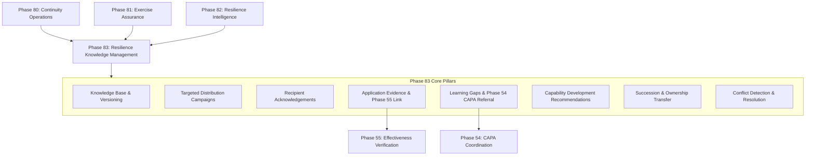
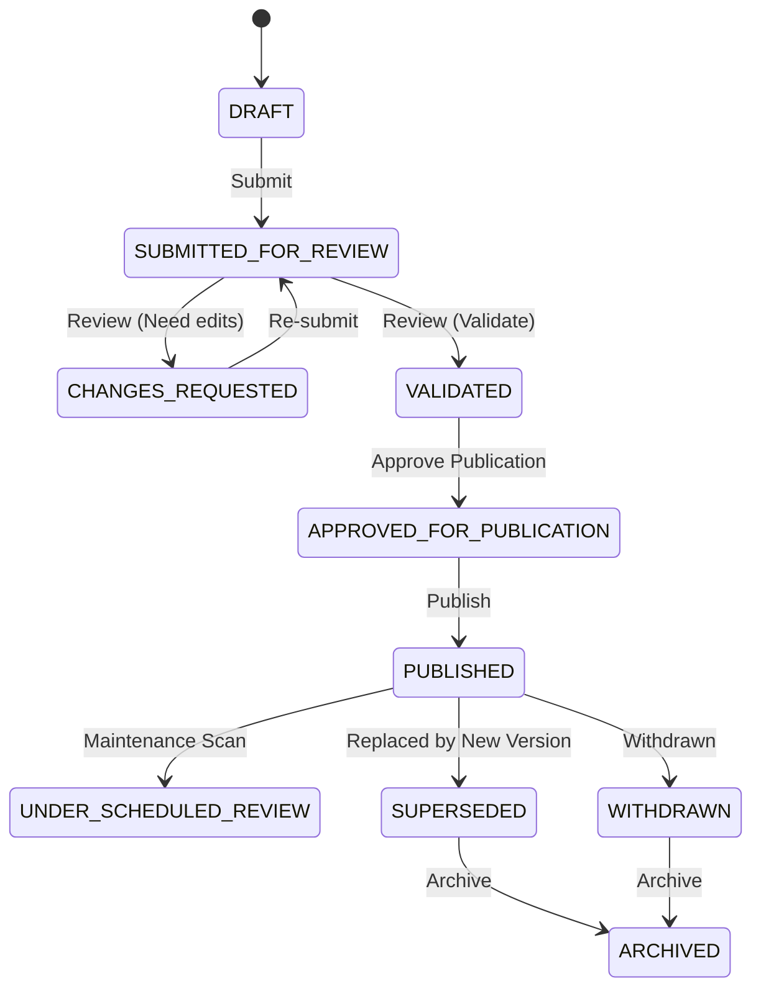

# Phase 83: Clinical Safety Governance Resilience Knowledge Management, Organizational Learning & Continuous Preparedness Capability Development

## Overview

Phase 83 delivers a production-grade resilience knowledge management and organizational learning capability for HealthSetu. It converts validated resilience insights from Phase 80 (Continuity Operations), Phase 81 (Continuity Assurance & Exercises), and Phase 82 (Adaptive Preparedness Intelligence) into structured, version-controlled organizational learning, reusable operating guidance, and sustained capability development.

---

## Mandatory Clinical Safety Disclaimer

> [!IMPORTANT]
> **Mandatory Disclaimer**:
> `"Resilience knowledge management and organizational learning records are administrative capability development instruments and do NOT constitute proof of clinical safety, regulatory compliance, operational competency, or effective recovery. Phase 83 does not replace authoritative workflows of Phases 49, 54, 55, 63, 67, 69, 70, 72, 73, 74, 75, 76, 77, 78, 79, 80, 81, or 82."`

---

## 1. 12 Knowledge Categories

1. `VALIDATED_LESSONS_LEARNED`: Retrospective insights distilled from disruptions or exercises.
2. `CONTINUITY_OPERATING_GUIDANCE`: Standard operating steps during degraded mode.
3. `RECOVERY_COORDINATION_GUIDANCE`: Steps to coordinate multi-system recovery.
4. `EXERCISE_LEARNING`: Insights and observations gained during scheduled simulation drills.
5. `DEPENDENCY_MANAGEMENT_GUIDANCE`: Procedures to address vendor or upstream dependency outages.
6. `GOVERNANCE_DECISION_CONTINUITY`: Authority chains and protocols when executives are unavailable.
7. `EVIDENCE_RECONCILIATION_GUIDANCE`: Post-recovery clinical audit and reconciliation protocols.
8. `DELEGATED_AUTHORITY_GUIDANCE`: Rules governing emergency delegation and authority handover.
9. `PERSONNEL_READINESS_GUIDANCE`: Competency and training requirements for backup staff.
10. `OPERATIONAL_HANDOFF_GUIDANCE`: Protocols for shift changes and inter-facility handoffs.
11. `PREPAREDNESS_IMPROVEMENT_GUIDANCE`: Actionable guidance to upgrade readiness posture.
12. `ORGANIZATIONAL_RESILIENCE_PRACTICES`: Systemic best practices across health networks.

---

## 2. Knowledge Lifecycle & Separation of Duties

### Separation of Duties Rules
1. **Author/Owner Self-Validation Prohibited**: The author or owner of a knowledge record cannot act as its reviewer/validator (`KNOWLEDGE_SEPARATION_OF_DUTIES_VIOLATION`, HTTP 400).
2. **Author/Owner Self-Approval Prohibited**: The author or owner cannot approve publication of their own record (`KNOWLEDGE_SEPARATION_OF_DUTIES_VIOLATION`, HTTP 400).
3. **Distribution Gate**: Distribution campaigns may **only** be created for knowledge that is in `APPROVED_FOR_PUBLICATION` or `PUBLISHED` state (`UNPUBLISHED_KNOWLEDGE_DISTRIBUTION_DENIED`, HTTP 400).
4. **Application Evidence Verification**: Submitter of application evidence cannot verify the evidence (`KNOWLEDGE_SEPARATION_OF_DUTIES_VIOLATION`, HTTP 400).
5. **Succession Verification**: Neither the transferring owner nor the successor owner may verify the ownership transfer (`KNOWLEDGE_SEPARATION_OF_DUTIES_VIOLATION`, HTTP 400). An independent third party is required.
6. **Patient Access Block**: All endpoints are protected with `_ensure_not_patient`, rejecting patient tokens immediately with HTTP 403 `INSUFFICIENT_PERMISSIONS`.

---

## 3. API Endpoints Summary

Base Path: `/api/v1/governance-resilience-knowledge`

### Knowledge Management
- `POST /` — Create resilience knowledge asset (DRAFT)
- `GET /` — List knowledge assets with category/state filters
- `POST /search` — Full-text and tag-filtered search
- `GET /{knowledge_id}` — Retrieve knowledge details
- `PUT /{knowledge_id}` — Update knowledge (supports material version increments)
- `POST /{knowledge_id}/submit` — Submit for independent review
- `POST /{knowledge_id}/review` — Review (Validate, request changes, reject)
- `POST /{knowledge_id}/approve` — Approve for publication
- `POST /{knowledge_id}/publish` — Publish guidance
- `POST /{knowledge_id}/withdraw` — Withdraw guidance with recorded reason
- `POST /{knowledge_id}/supersede` — Mark superseded by replacement record

### Campaigns & Tracking
- `POST /campaigns` — Create targeted distribution campaign (enforces distribution gate)
- `GET /campaigns` — List campaigns
- `GET /campaigns/{campaign_id}` — Get campaign details
- `POST /campaigns/{campaign_id}/approve` — Approve campaign
- `POST /campaigns/{campaign_id}/dispatch` — Dispatch campaign (seeds recipient acknowledgements)
- `POST /campaigns/{campaign_id}/complete` — Complete campaign
- `GET /acknowledgements` — List user acknowledgements
- `POST /acknowledgements/{acknowledgement_id}/record` — Record user view/acknowledgement
- `POST /evidence` — Submit practical application evidence (with Phase 55 link)
- `GET /evidence` — List application evidence
- `POST /evidence/{evidence_id}/verify` — Independently verify evidence

### Gaps, Recommendations & Succession
- `POST /gaps` — Identify organizational learning gap
- `GET /gaps` — List learning gaps
- `POST /gaps/{gap_id}/validate` — Validate learning gap (required before CAPA referral)
- `POST /gaps/{gap_id}/refer-capa` — Refer validated gap to Phase 54 CAPA
- `POST /gaps/{gap_id}/resolve` — Mark gap resolved
- `POST /recommendations` — Propose capability development recommendation
- `GET /recommendations` — List recommendations
- `PUT /recommendations/{recommendation_id}/status` — Update recommendation status
- `POST /transfers` — Initiate knowledge succession transfer
- `GET /transfers` — List transfers
- `PUT /transfers/{transfer_id}/checklist` — Update handoff checklist
- `POST /transfers/{transfer_id}/complete` — Complete handoff
- `POST /transfers/{transfer_id}/verify` — Verify transfer (independent third-party check)
- `POST /conflicts` — Detect knowledge conflict
- `GET /conflicts` — List conflicts
- `POST /conflicts/{conflict_id}/resolve` — Resolve conflict (optionally supersede conflicting asset)

### Reports & Scans
- `GET /reports/inventory` — Knowledge base inventory report
- `GET /reports/distribution-compliance` — Distribution compliance report
- `GET /reports/application-evidence` — Application evidence report
- `GET /reports/learning-gaps` — Learning gaps and CAPA referral report
- `GET /reports/capability-development` — Capability development progress report
- `GET /reports/succession` — Knowledge succession health report
- `GET /reports/maturity` — Resilience preparedness maturity report
- `POST /maintenance/scan` — Routine maintenance scan for outdated guidance and open gaps
