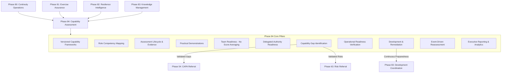

# Phase 84: Clinical Safety Governance Organizational Resilience Capability Assessment, Competency Assurance & Operational Readiness Verification

## Overview

Phase 84 implements an evidence-based organizational resilience capability assessment and operational readiness verification capability for HealthSetu. It determines whether organizational teams and authorized personnel demonstrate the knowledge, role-specific capabilities, coordination skills, and operational readiness required to execute assigned governance resilience responsibilities.

---

## Mandatory Clinical Safety Disclaimer

> [!IMPORTANT]
> **Mandatory Clinical Safety Disclaimer**:  
> `"Organizational resilience capability assessments and operational readiness verification records are administrative governance instruments and do NOT constitute professional licensing, clinical credentialing, medical competence certification, or authorization for clinical practice. Phase 84 does not replace authoritative workflows of Phases 49, 54, 55, 63, 67, 69, 70, 72, 73, 74, 75, 76, 77, 78, 79, 80, 81, 82, or 83."`

---

## Key Capability Domains

1. **Governance Continuity**: Awareness of continuity activation authority, procedures, and alternate governance chains.
2. **Recovery Coordination**: Multi-system task handoffs, dependency tracking, and inter-facility recovery synchronization.
3. **Decision Continuity**: Emergency decision documentation, delegated authority limits, and provenance preservation.
4. **Evidence Continuity**: Record integrity preservation, audit logging in degraded mode, and reconciliation protocols.
5. **Personnel Readiness**: Role-specific awareness, backup coverage preparedness, and escalation pathway fluency.
6. **Dependency Management**: Single point of failure (SPOF) recognition and vendor contingency execution.
7. **Exercise Participation**: Simulation drill execution, tabletop scenario contributions, and post-exercise learning.

---

## Crucial Governance Rules & Safety Invariants

1. **Strict Score Distinction**: Team readiness is **never** calculated as a simple mathematical average of individual assessment scores. Missing critical roles or backup coverage deficits remain explicitly visible (`CRITICAL_ROLES_VACANT`, `BACKUP_COVERAGE_DEFICIT`).
2. **Separation of Duties**:
   - Framework creator cannot approve their own framework (`CAPABILITY_SEPARATION_OF_DUTIES_VIOLATION`, HTTP 400).
   - Assessment subject cannot act as their own assessor or reviewer (`CAPABILITY_SEPARATION_OF_DUTIES_VIOLATION`, HTTP 400).
   - Assessor cannot act as the independent verifier (`CAPABILITY_SEPARATION_OF_DUTIES_VIOLATION`, HTTP 400).
   - Operational readiness assessor cannot verify their own readiness determination (`CAPABILITY_SEPARATION_OF_DUTIES_VIOLATION`, HTTP 400).
   - Gap identifier cannot validate their own capability gap (`CAPABILITY_SEPARATION_OF_DUTIES_VIOLATION`, HTTP 400).
3. **No Autonomous Clinical Credentialing**: Does NOT grant medical practice authority, modify clinical credentials, or alter legal delegations.
4. **Patient Access Block**: All endpoints are protected with `_ensure_not_patient`, returning HTTP 403 `INSUFFICIENT_PERMISSIONS` on any patient token attempt.

---

## API Summary

Base Path: `/api/v1/governance-resilience-capability`

### Frameworks & Roles
- `POST /frameworks` — Create versioned capability framework
- `GET /frameworks` — List frameworks
- `GET /frameworks/{id}` — Get framework details
- `PATCH /frameworks/{id}` — Update framework (increments version if published)
- `GET /frameworks/{id}/versions` — Get historical versions
- `POST /frameworks/{id}/submit` — Submit framework for review
- `POST /frameworks/{id}/approve` — Approve framework (creator prohibited)
- `POST /frameworks/{id}/publish` — Publish framework
- `POST /role-requirements` — Map role competency requirements
- `GET /role-requirements` — List role requirements
- `GET /role-requirements/{id}` — Get role requirement
- `POST /role-requirements/{id}/approve` — Approve role requirement

### Assessments & Demonstrations
- `POST /assessments` — Create capability assessment
- `GET /assessments` — List assessments
- `POST /assessments/{id}/schedule` — Schedule assessment with assessor
- `POST /assessments/{id}/submit-evidence` — Submit supporting evidence
- `POST /assessments/{id}/review` — Review and score capability outcome
- `POST /assessments/{id}/verify` — Independently verify assessment outcome
- `GET /assessments/{id}/history` — Get historical assessment versions
- `POST /demonstrations` — Record practical capability demonstration
- `GET /demonstrations` — List demonstrations
- `POST /demonstrations/{id}/review` — Review demonstration observation

### Team & Delegated Readiness
- `POST /teams/{team_id}/assess-readiness` — Assess team readiness (explicit vacancy detection)
- `GET /teams/{team_id}/readiness` — Get team readiness history
- `GET /team-readiness` — List team readiness records
- `POST /delegated-authority-readiness/assess` — Assess delegate operational readiness
- `GET /delegated-authority-readiness` — List delegated readiness records

### Gaps, Operational Readiness & Remediation
- `POST /capability-gaps` — Detect capability gap
- `GET /capability-gaps` — List capability gaps
- `POST /capability-gaps/{id}/validate` — Validate gap (human review prerequisite)
- `POST /capability-gaps/{id}/disposition` — Disposition gap (Phase 54 CAPA / Phase 63 Risk referral)
- `POST /readiness/assess` — Assess operational readiness (organization, facility, department, team)
- `GET /readiness` — List operational readiness records
- `POST /readiness/{id}/verify` — Independently verify operational readiness
- `POST /development-proposals` — Propose remediation development plan
- `GET /development-proposals` — List development proposals
- `POST /development-proposals/{id}/approve` — Approve development proposal
- `POST /development-proposals/{id}/complete` — Mark development plan complete
- `POST /reassessments` — Trigger event-driven or scheduled reassessment
- `GET /reassessments` — List reassessments
- `POST /reassessments/{id}/complete` — Complete reassessment

### Reports
- `GET /reports/capability-coverage` — Framework capability coverage report
- `GET /reports/role-readiness` — Role-specific competency readiness report
- `GET /reports/team-readiness` — Team readiness & critical vacancies report
- `GET /reports/capability-gaps` — Capability gaps & disposition report
- `GET /reports/development-progress` — Development remediation progress report
- `GET /reports/organizational-readiness` — Overall organizational readiness posture report
